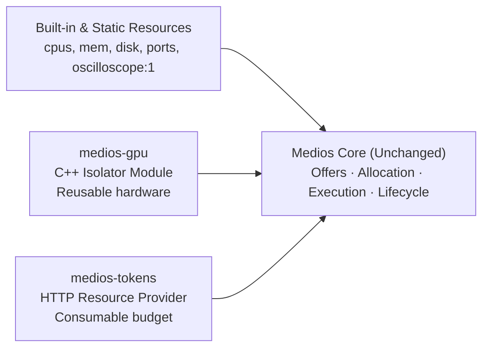

# Extending Resources

**Medios brokers resources it does not need to understand.**

The controller does not know what an H100 is, how an API provider bills for tokens, or how a piece of lab equipment is reserved. It manages offers, allocations, and task lifecycle while operators and resource providers supply the domain-specific semantics around it.



## Three ways to model scarce resources

1. **Static named scalars (`--resources`):** For mutually exclusive equipment (`oscilloscope:1`, `bench_rig:1`) or fixed concurrency slots (`api_slots:4`) that need no kernel enforcement or dynamic supply, declare the resource name directly in `medios-node --resources`. Medios offers, carves, and restores it automatically with zero extra code.
2. **In-process `Isolator` module (`medios-gpu`):** For hardware that requires kernel or container enforcement at launch (`prepare`, `isolate`, `cleanup`, and restart `recover`), load a shared library via `--modules` and `--isolation`. `medios-gpu` proves you can extend the **resource vocabulary** without modifying Medios core.
3. **External HTTP `ResourceProvider` (`medios-tokens`, Research Preview):** For dynamic or non-hardware capacity — API token budgets, rate limits, external leases — run an out-of-process HTTP client against `medios-node` `POST /api/v1/resource_provider`. `medios-tokens` proves you can extend **resource lifecycle semantics** (reusable to consumable) without modifying Medios core.

## How this differs from AI gateways and cluster quotas

Most LLM stacks enforce token budgets at one of two disconnected layers:

- **L7 AI gateways (LiteLLM, Portkey, Envoy AI Gateway):** Intercept HTTP traffic *after* a task is already scheduled and return HTTP `429` once a key or token bucket is exhausted. Because the cluster scheduler is blind to gateway budgets, multi-step agent pipelines still claim compute and burn partial work before failing mid-flight.
- **Cluster extended resources (Kubernetes device plugins, Ray custom resources, Slurm GRES/TRES):** Model *reusable* capacity (allocate on start, release on exit) or post-hoc accounting rather than a real-time consumable `reserve -> spend -> settle` financial ledger.

Brokering `token_budget` through an HTTP `ResourceProvider` exposes live remaining spend **atomically inside the same resource offer as `cpus`, `mem`, and `gpus`** before a container ever launches. Budget-aware schedulers can pre-plan multi-step chains, downgrade model tiers below a watermark, or wait cleanly without burning partial runs—while keeping zero accounting logic inside Medios core.

See the accompanying research preview technical note in [`medios-lab/medios-tokens/papers/`](https://github.com/medios-lab/medios-tokens/tree/main/papers) for the full protocol analysis and live multi-agent contention benchmarks.

## Reference pair: `medios-gpu` vs. `medios-tokens`

| Dimension | `medios-gpu` | `medios-tokens` |
| --- | --- | --- |
| **Resource** | GPU capacity | API token budget |
| **Source of truth** | Host GPU hardware and driver runtime | External API or account ledger |
| **Resource behavior** | Reusable | Consumable |
| **Availability** | Device inventory and allocation | Balance, reservations, replenishment |
| **Lifecycle** | Acquire → use → release | Reserve → spend → settle |
| **Extension seam** | C++ `Isolator` module (`--modules`) | Out-of-process HTTP `ResourceProvider` (`/api/v1/resource_provider`) |
| **Restart safety** | Per-container device UUID checkpoint in sandbox | Atomic local JSON ledger checkpoint (`provider_id`, balance, tasks) |
| **Core Medios modifications** | None | None |

## How an HTTP Resource Provider works (`medios-tokens`)

An external provider runs beside `medios-node` with zero C++ or ABI coupling:

1. **Subscribe:** `POST http://<node>:5051/api/v1/resource_provider` with `{"type": "SUBSCRIBE", "subscribe": {"resource_provider_info": ...}}`. Save the returned `Medios-Stream-Id` header and `SUBSCRIBED` `provider_id`.
2. **Advertise supply:** Send `UPDATE_STATE` carrying provider-scoped scalar resources (`provider_id` set on each `Resource`). The node forwards the total to `medios-controller`, and frameworks immediately see `token_budget` inside `OFFERS` alongside `cpus` and `mem`.
3. **Authorize reservations:** When a framework accepts an offer carving a provider-scoped resource, `medios-node` sends `Event::PUBLISH_RESOURCES` before launching the container and again on executor registration. The provider treats `PUBLISH_RESOURCES` as an idempotent admission gate and replies `UPDATE_PUBLISH_RESOURCES_STATUS` (`OK` or `FAILED`).
4. **Debit, settle, and replenish:** The provider watches controller `POST /api/v1` `SUBSCRIBE` (`TASK_ADDED`) to debit each unique `task_id` once, optionally reconciles actual consumption to release unused credit (`reserved - actual`), and calls `UPDATE_STATE` whenever its balance changes.

Example ledger progression observed on an unmodified cluster starting with `cpus: 4`, `oscilloscope: 1`, and `token_budget: 100`:

```text
UPDATE_STATE token_budget=100 (initial)
UPDATE_STATE token_budget=75  (debited 25 for task task-1; oscilloscope returns to 1 on finish)
UPDATE_STATE token_budget=82  (settled task task-1 actual=18 delta=+7)
UPDATE_STATE token_budget=0   (debited 82 for task task-2; cpus=4.0 idle, token_budget exhausted)
UPDATE_STATE token_budget=40  (refill +40 via SIGUSR1; offers resume immediately)
```

## What's next

- [Budget LLM Token Spend with `medios-tokens`](/workloads/token-budget-tutorial) — step-by-step tutorial covering Task Finish Hook settlement and per-task scoped OpenRouter keys
- [Resource Offers & Accounting](/architecture/offers)
- [Declaring GPUs & Hardware](/operations/gpus)
- [OpenAPI Discovery & Specs](/api/openapi) — full `ResourceProviderCall` and `ResourceProviderEvent` schemas in `node.openapi.json`
