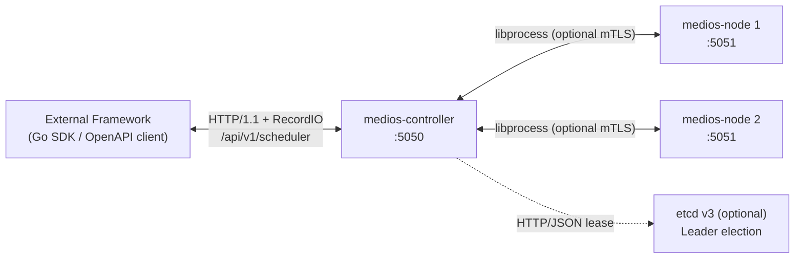

# Architecture

Medios is a two-daemon resource broker. `medios-controller` coordinates offers and task lifecycle across the cluster; `medios-node` runs on each compute machine, enforces declared resource limits, and launches executors.

## Cluster topology

## Control plane and data plane boundary

- **Platform responsibility:** node registration, resource accounting, offer generation, container/process isolation, executor supervision, and at-least-once status delivery.
- **Framework responsibility:** job queues, placement decisions, offer acceptance or decline, failure retries, and application-level state.

## Terminology

Medios uses **`controller`** for the cluster coordinator and **`node`** for the machine-side daemon. The word **`agent`** refers strictly to AI or agentic concepts such as LLM-driven schedulers and autonomous workloads.

## Core architectural components

- [Resource Offers & Accounting](/architecture/offers) — how offers, carving, roles, reservations, and gang requests work.
- [Extending Resources](/architecture/extending-resources) — extending resource vocabulary (`medios-gpu`) and consumable lifecycle semantics (`medios-tokens`) with zero core modifications.
- [Containerizers & Isolation](/architecture/containerizers) — `medios` vs. `docker_shell`, cgroups, namespaces, and POSIX rlimits.
- [Task Lifecycle & Sandboxes](/architecture/task-lifecycle) — task states, executor handoff, and sandbox file layout.
- [Networking Model](/architecture/networking) — host addressing, port ranges, and containerizer port binding.

## What's next

- [Cluster Operations](/operations) — persistence, etcd leader election, GPUs, and shared stores
- [Building Frameworks](/frameworks) — implement a scheduler against `/api/v1/scheduler`
