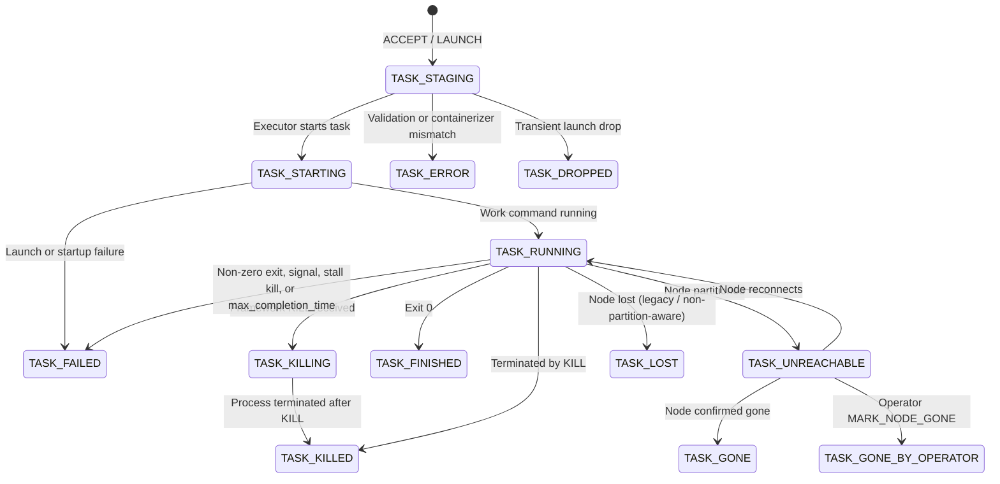

# Task Lifecycle & Sandboxes

Every accepted task progresses through a well-defined sequence of status updates reported from the node to the controller and streamed to the framework.

## Task states



- **Active states:** `TASK_STAGING`, `TASK_STARTING`, `TASK_RUNNING`, `TASK_KILLING`, `TASK_UNREACHABLE`.
- **Terminal states:** `TASK_FINISHED`, `TASK_FAILED`, `TASK_KILLED`, `TASK_ERROR`, `TASK_DROPPED`, `TASK_LOST`, `TASK_GONE`, `TASK_GONE_BY_OPERATOR`.
- **Pre-launch rejections** surface as `TASK_ERROR` (permanent framework error) or `TASK_DROPPED` (transient), always carrying a `TaskStatus.Reason` and a machine-greppable `message`.

## Sandbox directory layout

Each task run gets an isolated working directory under the node's `--work_dir`:

```text
<node-work-dir>/nodes/<node-id>/frameworks/<framework-id>/executors/<executor-id>/runs/<container-id>/
├── stdout
├── stderr
├── observers/
│   └── <observer-name>.stderr
├── finish.stdout
├── finish.stderr
└── <files written by the task>
```

| Path segment | Source |
| --- | --- |
| `<node-work-dir>` | Node's `--work_dir` flag (discoverable via `GET http://<node>:5051/state`) |
| `<node-id>` | `Offer.node_id.value` |
| `<framework-id>` | `SUBSCRIBED` event's `framework_id.value` |
| `<executor-id>` | `TaskStatus.executor_id.value` (for default command tasks, `medios-node` sets `executor_id` equal to `task_id.value`; for custom executors or task groups, use `ExecutorInfo.executor_id.value`) |
| `<container-id>` | `TaskStatus.container_status.container_id.value` from the first `TASK_RUNNING` update |

Medios writes `stdout` and `stderr` directly without built-in log rotation. Configure retention and collection in your host or platform logging pipeline.

## What's next

- [Reading Task Sandboxes](/frameworks/sandboxes)
- [Task State Reasons](/reference/task-state-reasons)
