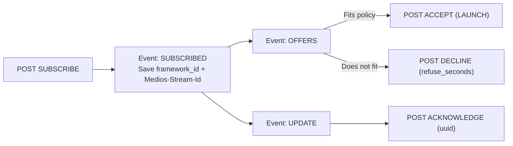

# Building Frameworks

A Medios framework is an HTTP client that subscribes to `/api/v1/scheduler`, decides which offers to accept or decline, and reacts to task status updates.

## The scheduler loop

## Choose your client path

- **Go (reference SDK):** Start with [Go SDK](/go-sdk) (`medios-lab/medios-sdk-go`), which handles RecordIO framing, `Medios-Stream-Id`, resource carving, offer helpers, sandbox tailing, and SQLite state persistence.
- **Any other language or AI agent:** Use the embedded [OpenAPI Discovery & Specs](/api/openapi) with [RecordIO Framing](/api/recordio) and the [Scheduler Contract & Best Practices](/frameworks/contract).
- **C++:** Link [C++ Scheduler Driver](/frameworks/cpp-driver) (`MediosSchedulerDriver`).

## Guides in this section

- [Scheduler Contract & Best Practices](/frameworks/contract)
- [Reading Task Sandboxes](/frameworks/sandboxes)
- [AI Agents as Frameworks](/frameworks/agents)
- [C++ Scheduler Driver](/frameworks/cpp-driver)
- [Ray on Medios](/frameworks/ray-on-medios) — KubeRay-compatible framework running stock Ray on Medios
