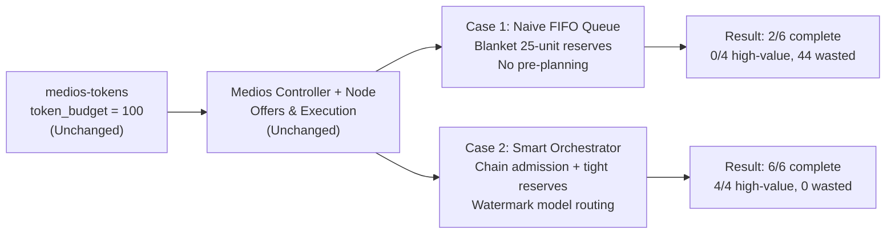

# Advanced: multi-agent budget contention vs. orchestration

In the [previous tutorial](/workloads/token-budget-tutorial), you attached `medios-tokens` to a single cluster and settled individual tasks. Now look at what happens when **multiple agents share one `token_budget` pool**.

This walkthrough demonstrates the second half of Medios's two-level scheduling thesis: **mechanism lives in the broker and resource provider; policy lives in the scheduler.**

Using the exact same unmodified `medios-controller`, `medios-node`, and `medios-tokens` (`--initial=100 --cap=100`), we run six multi-agent workflows under two schedulers:

- **Case 1 — Naive FIFO Queue Contention:** A plain FIFO queue accepts offers greedily with blanket worst-case reservations (`25` units per step), no priority, no chain pre-planning, and no model-tier downgrading.
- **Case 2 — Smart Budget Orchestrator:** A budget-aware scheduler applies full-chain admission, tight per-step reservations with immediate settlement recycling, and watermark-driven model routing.



## The workload

Six multi-agent workflows arrive against a single `100`-unit `token_budget` pool:

| Workflow class | Count | Steps | Actual spend per workflow | Notes |
| --- | --- | --- | --- | --- |
| **High-value research chains** (`research-1` .. `research-4`) | 4 | `plan` (5) → `gather` (8) → `synthesize` (7) | `20` units (`80` total) | Partial completion has zero value if step 3 cannot run |
| **Low-value background digests** (`digest-1`, `digest-2`) | 2 | `summarize` | `18` units on standard model (`6` on cheap model) | Tolerates routing to a faster, cheaper model under budget pressure |

Notice the arithmetic: all four high-value workflows need only `80` units total, leaving `20` units for background work. The pool is big enough for **all six workflows**—if the scheduler coordinates spend.

## 1. Run the live side-by-side benchmark

The runnable benchmark lives in `medios-lab/medios-tokens` under `examples/multi-agent-budget/benchmark.py`. It launches a fresh `medios-controller`, `medios-node`, and `medios-tokens` for each case, executes every step as a real Medios task, debits on `TASK_ADDED`, and settles actual spend via `POST /settle`:

```sh
cd medios-tokens
python3 examples/multi-agent-budget/benchmark.py \
  --medios-build /path/to/medios/build \
  --provider-bin ./medios-tokens
```

Observed live output:

```text
=== Multi-Agent Token Budget Benchmark (100-unit pool, 6 workflows) ===
Metric                       Case 1: Naive Queue      Case 2: Smart Orchestrator
------------------------------------------------------------------------------
High-value workflows (3-step) 0/4                      4/4
Low-value digests            2/2                      2/2
Total completed              2/6                      6/6
Wasted on stranded work      44.0                     0
Remaining token_budget       20                       8
Wall time (s)                8.89                     8.35

BENCHMARK VERIFIED: same broker, same medios-tokens, policy in the scheduler.
```

## 2. Why Case 1 (Naive FIFO Queue) fails

`medios-tokens` does its job: the cluster never overspends the `100`-unit cap. Yet **zero** high-value workflows finish:

1. **Priority inversion:** Both low-value `digest` tasks arrive interleaved in the FIFO queue and run on the expensive standard model, consuming `36` units immediately.
2. **Stranded partial pipelines:** The remaining `64` units get split across `plan` and `gather` steps of the four `research` workflows (`44` units spent on incomplete chains).
3. **Reservation fragmentation:** With `20` units left in `token_budget`, none of the stranded workflows can reserve the blanket `25`-unit worst-case chunk required for `synthesize`. Every offer carrying `token_budget: 20` is declined, leaving `44` units wasted and `20` units unusable.

## 3. How Case 2 (Smart Budget Orchestrator) solves it

The smart scheduler reads the exact same `OFFERS` stream and applies three lightweight policies—still with zero changes to Medios core or `medios-tokens`:

1. **Full-chain admission (pre-planning):** Before launching step 1 of a research workflow, the orchestrator checks `offer.token_budget - committed_high >= chain_cost`. It never starts a chain that cannot afford to reach `synthesize`.
2. **Right-sized reservations + settlement recycling:** Instead of blanket `25`-unit reservations, each step reserves close to its expected ceiling (`8`, `10`, `9`) and immediately settles actual spend (`5`, `8`, `7`). Returned credit flows straight into the next `UPDATE_STATE` offer.
3. **Watermark-driven model routing:** Once the high-value workflows finish, `token_budget` stands at `20`—below the orchestrator's `25`-unit watermark. Instead of failing or blocking, the orchestrator automatically routes `digest-1` and `digest-2` to the cheap model tier (`6` units actual each), completing both background tasks with `8` units to spare.

## Key architectural takeaway

Medios does not ship built-in multi-agent priority queues, DAG planners, or LLM model routers—and `medios-tokens` does not need to know about workflow graphs or model tiers either.

Because Medios exposes remaining `token_budget` directly inside `OFFERS`, any orchestrator framework can turn live supply signals into admission control, backpressure, and model-tier routing without touching a single line of the broker.

## What's next

- [Budget LLM Token Spend with `medios-tokens`](/workloads/token-budget-tutorial) — foundational tutorial for Pattern 1 (finish hooks) and Pattern 2 (OpenRouter scoped keys)
- [Extending Resources](/architecture/extending-resources) — how `medios-gpu` and `medios-tokens` extend Medios without core modifications
- [Building Frameworks](/frameworks) — write your own custom scheduler in Go or Python
