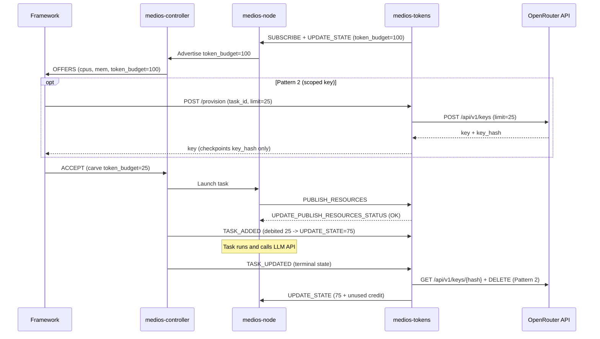

# Budget LLM token spend with `medios-tokens`

:::note Research Preview
`medios-tokens` is a **research preview** reference implementation demonstrating consumable API budgets on an unmodified Medios broker (single provider, single node). See the accompanying [technical note (PDF & LaTeX)](https://github.com/medios-lab/medios-tokens/tree/main/papers) for the experimental writeup.
:::

In about ten minutes you will attach [`medios-tokens`](https://github.com/medios-lab/medios-tokens) to an unmodified Medios cluster, watch a consumable `token_budget` scalar appear in node offers alongside `cpus` and `mem`, and settle real task spend back into the pool using two patterns:

1. **Pattern 1 — Task Finish Hook settlement:** The task records its spend in `./usage.json`, and Medios's `TaskInfo.finish` hook posts actual consumption to `POST /settle`. Works with any LLM provider and fails closed if usage is missing.
2. **Pattern 2 — Per-task scoped OpenRouter keys:** Before launching a task, the framework mints a hard-capped ephemeral key via `POST /provision`. When the task reaches any terminal state (`TASK_FINISHED`, `TASK_FAILED`, `TASK_KILLED`, etc.), `medios-tokens` automatically reads exact spend from OpenRouter, revokes the key, and returns unused credit to Medios offers.

Neither pattern modifies Medios core. The controller continues brokering scalar offers without knowing what a token or an OpenRouter key is.



## What you need

- A running `medios-controller` at `http://127.0.0.1:5050` and `medios-node` at `http://127.0.0.1:5051` (see [Quick Start](/quick-start)).
- Go 1.26 or newer (`medios-tokens` uses the Go standard library only, with zero third-party dependencies).
- Optional for Pattern 2: an OpenRouter Management API key with read/write permissions (from OpenRouter **Settings → Management API Keys**).

## 1. Build and start `medios-tokens`

Clone and build the reference provider:

```sh
git clone https://github.com/medios-lab/medios-tokens.git
cd medios-tokens
go test -race ./...
go build -o medios-tokens ./cmd/medios-tokens
```

Start `medios-tokens` beside your running controller and node with a durable ledger checkpoint and local admin server:

```sh
./medios-tokens \
  --controller=http://127.0.0.1:5050 \
  --node=http://127.0.0.1:5051 \
  --resource=token_budget \
  --initial=100 \
  --cap=100 \
  --refill-amount=40 \
  --state-file=/tmp/medios-tokens.state.json \
  --admin-addr=127.0.0.1:9095
```

You should see the provider subscribe and advertise the initial balance immediately:

```text
[medios-tokens] admin HTTP listening on http://127.0.0.1:9095 (/balance, /settle, /refill, /provision)
[medios-tokens] subscribed provider_id=<uuid> resource=token_budget balance=100
[medios-tokens] UPDATE_STATE token_budget=100 (initial)
```

Verify the live ledger snapshot:

```sh
curl -s http://127.0.0.1:9095/balance
```

Frameworks subscribed to `/api/v1/scheduler` now receive `token_budget: 100` inside node offers alongside `cpus` and `mem`.

## 2. Pattern 1 — Settle spend with a Task Finish Hook

In Pattern 1, the task reserves its worst-case budget in `TaskInfo.resources`, writes actual spend into `./usage.json` inside its sandbox, and attaches a [Task Finish Hook](/workloads/finish-hooks) that runs after the work command exits—even on non-zero exit or framework kill.

The repository includes a complete worked example under `examples/finish-hook-settle/`:

- `work.sh` — runs either offline (`--fake-spend <N> [--fail]`) or against OpenRouter (`OPENROUTER_API_KEY`), writing `{"actual": <amount>}` to `./usage.json`.
- `settle-hook.sh` — reads `MEDIOS_TASK_ID` (injected by the executor) and `./usage.json`, then posts `{"task_id": "...", "actual": ...}` to `$MEDIOS_TOKENS_ADMIN_URL/settle`. If `./usage.json` is missing or malformed, the hook skips settlement and **fails closed** so the full reservation stays consumed.
- `task.json` — sample `TaskInfo` pairing `token_budget` with `TaskInfo.finish`:

```json
{
  "name": "llm-job-with-finish-settle",
  "task_id": { "value": "llm-job-001" },
  "resources": [
    { "name": "cpus", "type": "SCALAR", "scalar": { "value": 0.5 } },
    { "name": "mem", "type": "SCALAR", "scalar": { "value": 128 } },
    {
      "name": "token_budget",
      "type": "SCALAR",
      "scalar": { "value": 25 },
      "provider_id": { "value": "<provider-id-from-offer>" }
    }
  ],
  "command": {
    "shell": true,
    "value": "./work.sh --fake-spend 18"
  },
  "finish": {
    "cap": { "nanoseconds": 15000000000 },
    "command": {
      "shell": true,
      "value": "./settle-hook.sh",
      "environment": {
        "variables": [
          { "name": "MEDIOS_TOKENS_ADMIN_URL", "value": "http://127.0.0.1:9095" }
        ]
      }
    }
  }
}
```

Run the self-contained smoke test against a local Medios build to watch all three cases execute end-to-end:

```sh
python3 examples/finish-hook-settle/smoke.py \
  --medios-build /path/to/medios/build \
  --provider-bin ./medios-tokens
```

Expected output:

```text
1. PASS exit-0 settle (100 - 25 + 7 = 82): offer={'cpus': 2.0, 'mem': 1024.0, 'disk': 1024.0, 'token_budget': 82.0}
2. PASS exit-1 settle (82 - 25 + 15 = 72): offer={'cpus': 2.0, 'mem': 1024.0, 'disk': 1024.0, 'token_budget': 72.0}
3. PASS missing-usage fail-closed (72 - 25 = 47): offer={'cpus': 2.0, 'mem': 1024.0, 'disk': 1024.0, 'token_budget': 47.0}

=== ALL 3 FINISH-HOOK SETTLEMENT CASES PASSED ===
```

Notice case 3: when a task crashes without writing `./usage.json`, the hook refuses to guess and never refunds unverified capacity.

## 3. Pattern 2 — Enforce hard per-task caps with OpenRouter keys

Task-reported settlement works for cooperative workloads, but a runaway loop or killed process can still overspend a shared API key. Pattern 2 moves enforcement to the upstream provider edge:

1. Restart `medios-tokens` with your OpenRouter Management API key in the environment (or load it from your secret manager):

```sh
export OPENROUTER_PROVISIONING_KEY="<your-openrouter-management-key>"
./medios-tokens \
  --controller=http://127.0.0.1:5050 \
  --node=http://127.0.0.1:5051 \
  --initial=1.0 \
  --cap=1.0 \
  --state-file=/tmp/medios-tokens.state.json \
  --admin-addr=127.0.0.1:9095
```

2. Before accepting an offer for `task-1` (reserving `$0.05` of `token_budget`), the framework mints a scoped, hard-capped key:

```sh
curl -s -X POST http://127.0.0.1:9095/provision \
  -H 'Content-Type: application/json' \
  -d '{"task_id":"task-1","limit":0.05}'
```

`medios-tokens` calls `POST https://openrouter.ai/api/v1/keys`, returns the secret key once so the framework can inject it into the task's environment (`OPENROUTER_API_KEY`), and writes **only** the opaque `key_hash` to `/tmp/medios-tokens.state.json`. The raw secret is never persisted to disk.

3. Launch the task with that key. OpenRouter enforces the `$0.05` ceiling directly on every inference request.

4. When the task finishes, fails, or is killed, `medios-controller` emits a terminal `TASK_UPDATED` event (`TASK_FINISHED`, `TASK_FAILED`, `TASK_KILLED`, `TASK_LOST`, etc.). `medios-tokens` automatically:
   - Reads settled key usage from `GET /api/v1/keys/{hash}`
   - Revokes the key via `DELETE /api/v1/keys/{hash}` so it can never be reused
   - Credits unused budget (`reserved - actual`) back into the ledger and sends `UPDATE_STATE` to `medios-node`

```text
[medios-tokens] UPDATE_STATE token_budget=1 (initial)
[medios-tokens] UPDATE_STATE token_budget=0.95 (debited 0.05 for task task-1)
[medios-tokens] UPDATE_STATE token_budget=0.9985 (settled task task-1 actual=0.0015 delta=+0.0485)
[medios-tokens] auto-settled provisioned task task-1 on TASK_FINISHED actual=0.0015 delta=+0.0485 balance=0.9985
```

> **Note on sub-second tasks:** Upstream provider usage counters can lag by one to two seconds after a tiny completion. For typical multi-second LLM jobs this settles accurately; for sub-second micro-calls, keep this lag in mind when interpreting immediate zero-spend readings.

## 4. Replenish the budget externally

When `token_budget` hits `0`, Medios continues offering idle `cpus` and `mem`, while frameworks that require `token_budget` wait automatically until capacity is replenished.

Top up the ledger via HTTP (or send `kill -USR1 <pid>` to add `--refill-amount`, clamped at `--cap`):

```sh
curl -s -X POST http://127.0.0.1:9095/refill \
  -H 'Content-Type: application/json' \
  -d '{"amount":40}'
```

`medios-tokens` immediately pushes a fresh `UPDATE_STATE` to `medios-node`, and waiting frameworks receive new offers containing the replenished `token_budget`.

## Choosing between Pattern 1 and Pattern 2

| Consideration | Pattern 1 (Finish Hook) | Pattern 2 (Per-Task Scoped Keys) |
| --- | --- | --- |
| **Upstream provider coupling** | None — works with any API or local meter | Requires provider key-management API (OpenRouter built in; pluggable `Provisioner` interface) |
| **Hard spend ceiling** | Cooperative (enforced by task/wrapper) | Hard-enforced at the upstream API edge |
| **Crash or `SIGKILL` recovery** | Hook still runs on exit/kill; fails closed if `./usage.json` is absent | Automatic on any terminal `TASK_UPDATED` even if the node or container dies |
| **Credential hygiene** | Shared key across tasks | Ephemeral per-task key revoked immediately on termination; raw secret never written to disk |

## What you built

You added consumable budget semantics (`reserve -> spend -> settle -> refill`) to a Medios cluster using only the standard HTTP Resource Provider and operator event APIs—with zero changes to Medios core and zero C++ coupling.

## What's next

- [Advanced: Multi-Agent Budget Contention vs. Orchestration](/workloads/multi-agent-budget-tutorial) — see N agents compete over one `token_budget` pool under naive FIFO contention vs. a budget-aware orchestrator
- [Extending Resources](/architecture/extending-resources) — architectural comparison of `medios-gpu` and `medios-tokens`
- [Task Finish Hooks](/workloads/finish-hooks) — full specification of `TaskInfo.finish`, caps, and environment variables
- [`medios-tokens` repository](https://github.com/medios-lab/medios-tokens) — Go source, unit tests, and worked examples
